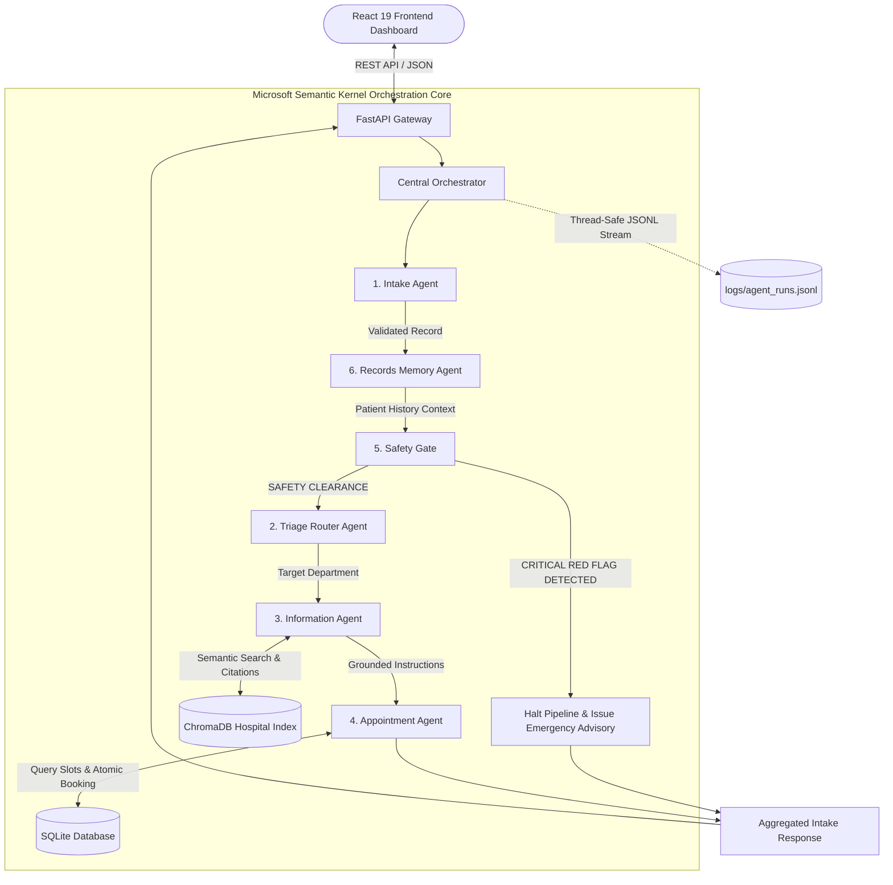
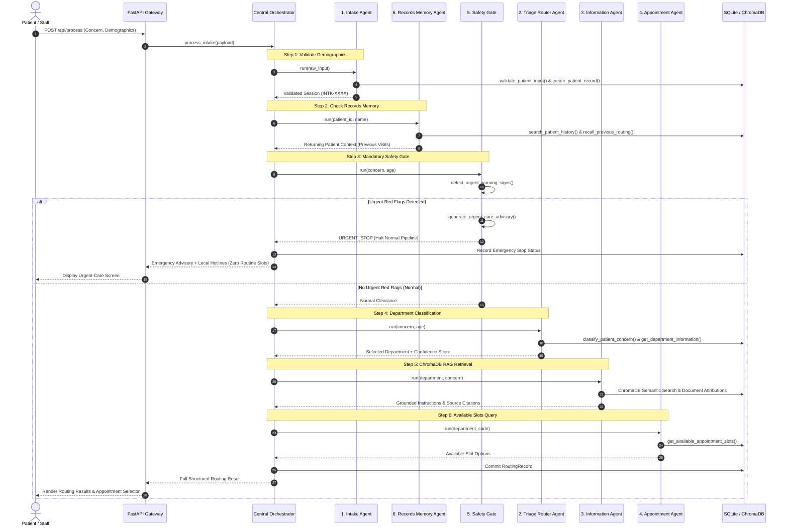
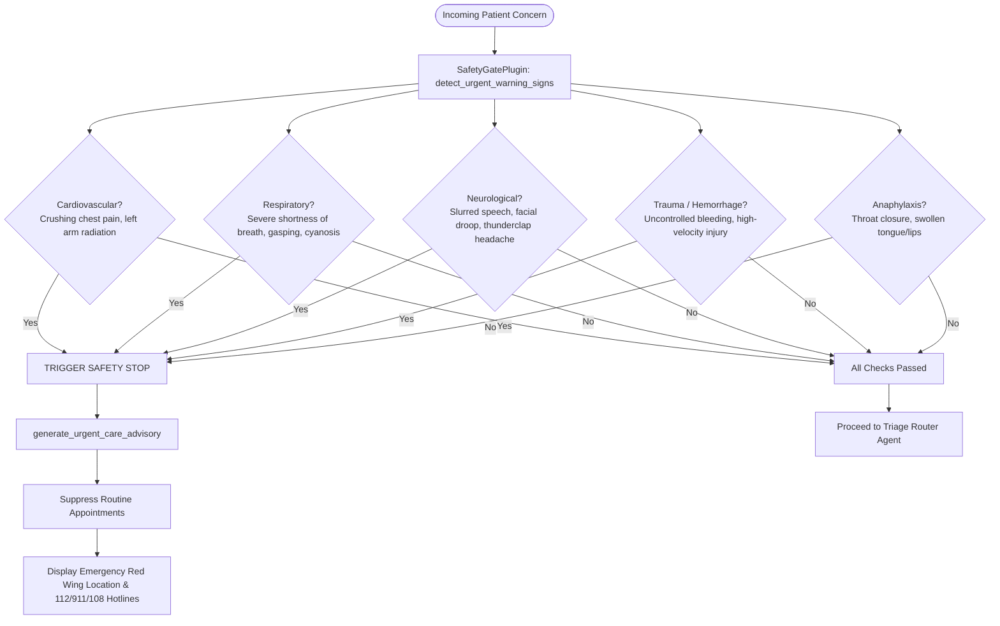
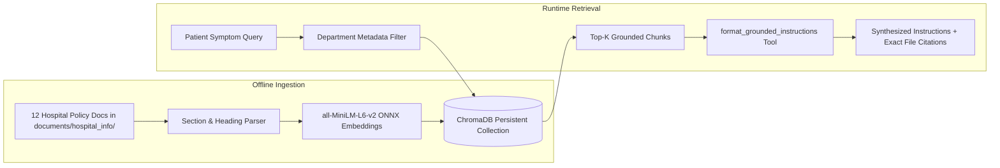
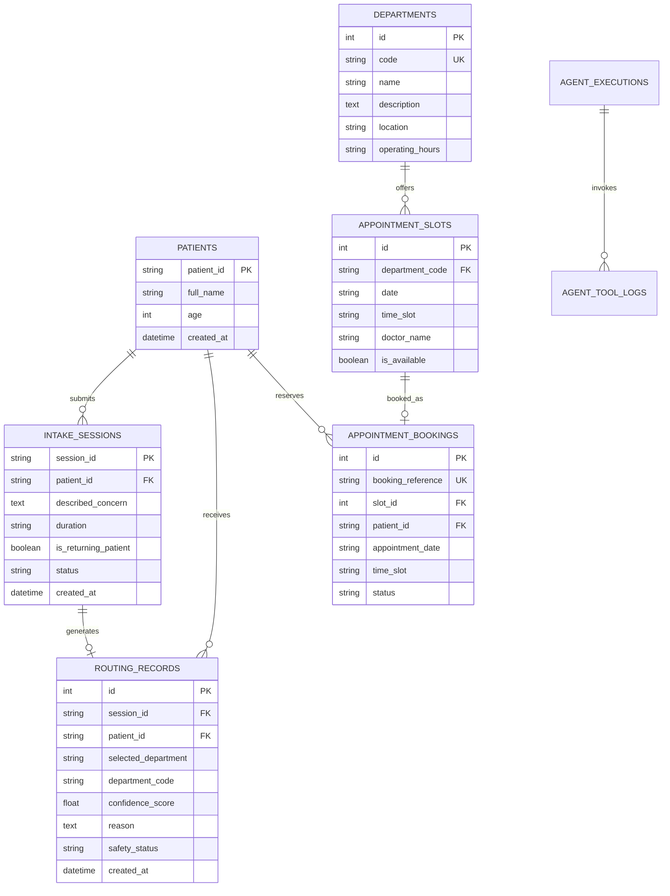

# System Architecture: Hospital Patient Intake & Department Routing Assistant

## 1. Executive Summary & Objective

The **Hospital Patient Intake and Department Routing Assistant** is an autonomous multi-agent healthcare coordination platform built on **Microsoft Semantic Kernel (v1.47.0)**, **ChromaDB Vector Retrieval (RAG)**, **FastAPI**, and **React + Tailwind CSS**. 

The system automates the administrative intake workflow: collecting patient complaints, screening for life-threatening emergency signs, recalling previous visit history for returning patients, routing concerns across 11 hospital departments, retrieving grounded clinical intake guidelines, and coordinating conflict-free demonstration appointment bookings.

> [!IMPORTANT]
> **Administrative Scope & Non-Diagnostic Guarantee**: CareRoute AI is strictly an administrative triage and hospital navigation system. It **never diagnoses diseases, prescribes pharmaceuticals, or replaces licensed medical evaluation**. Every patient response explicitly reinforces consultation with a qualified medical professional.

---

## 2. Why Routing with RAG Architecture Fits This Domain

1. **Deterministic Clinical Gating vs. Free-Form Hallucination**:
   Healthcare intake requires strict, deterministic boundaries. Combining rule-grounded triage routing with semantic vector retrieval prevents language models from fabricating hospital policies, misdirecting emergency patients, or hallucinating diagnoses.
2. **Dynamic Knowledge Separation**:
   Hospital operational policies (prep instructions, fasting requirements, required imaging) evolve frequently. Housing policy documents in a modular ChromaDB vector database allows hospital administrators to update clinical intake guidelines without fine-tuning models or rewriting core logic.
3. **Auditability & Traceability**:
   Every instruction returned to the patient cites its specific source document (e.g. `[source: orthopaedics.txt#Section 3]`). This enables rigorous healthcare auditing, compliance tracking, and administrative accountability.

---

## 3. High-Level System Architecture

---

## 4. Multi-Agent Roster & Tool Registry

Every agent is encapsulated as an independent Python module with real tool functions decorated with Semantic Kernel's `@kernel_function`:

| Agent Name | Primary Responsibility | Native Python Tools | Framework Integration |
| :--- | :--- | :--- | :--- |
| **1. Intake Agent** | Input validation, sanitization, and structured DB session persistence | `validate_patient_input()` `create_patient_record()` | `IntakePlugin` Semantic Kernel |
| **6. Records Memory Agent** | Returning patient identification, history recall, and reference generation | `search_patient_history()` `recall_previous_routing()` | `RecordsMemoryPlugin` Semantic Kernel |
| **5. Safety Gate** | Mandatory red-flag clinical symptom screening and emergency routing halt | `detect_urgent_warning_signs()` `generate_urgent_care_advisory()` | `SafetyGatePlugin` Semantic Kernel |
| **2. Triage Router Agent** | Symptom classification across 11 hospital departments with confidence scoring | `classify_patient_concern()` `get_department_information()` | `TriageRouterPlugin` Semantic Kernel |
| **3. Information Agent** | Semantic RAG retrieval over hospital policies and grounded instruction formatting | `retrieve_department_information()` `format_grounded_instructions()` | `InformationPlugin` Semantic Kernel |
| **4. Appointment Agent** | Demonstration slot availability query and atomic conflict-free reservation | `get_available_appointment_slots()` `reserve_appointment_slot()` | `AppointmentPlugin` Semantic Kernel |

---

## 5. Sequence & Orchestration Workflow

---

## 6. Safety Gate Decision Logic

The Safety Gate is an uncompromising barrier placed before normal outpatient routing. It screens symptoms across six high-risk clinical categories:

---

## 7. RAG Semantic Knowledge Pipeline

---

## 8. Database Entity Relationship Diagram (SQLite)

